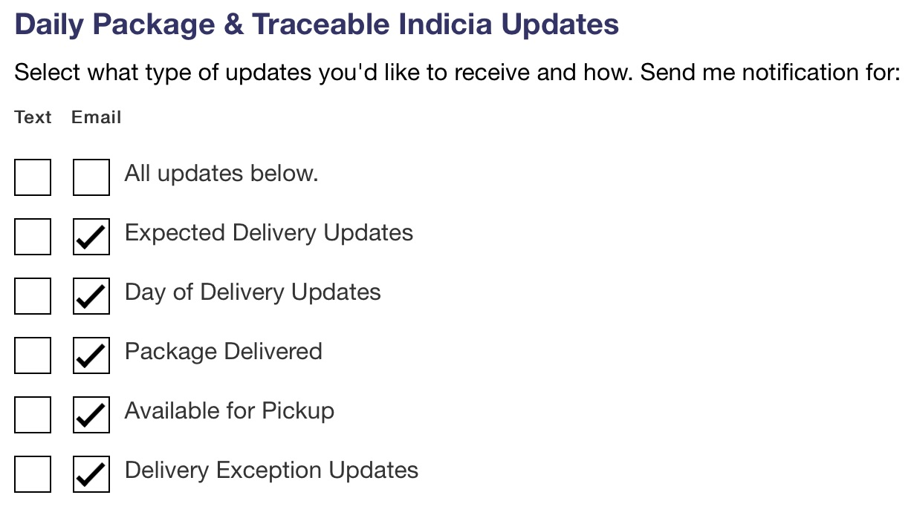
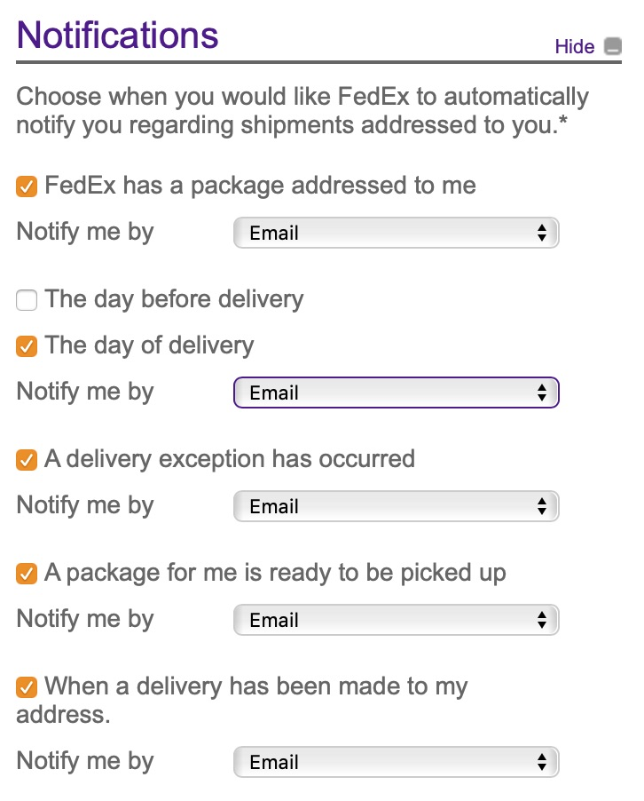
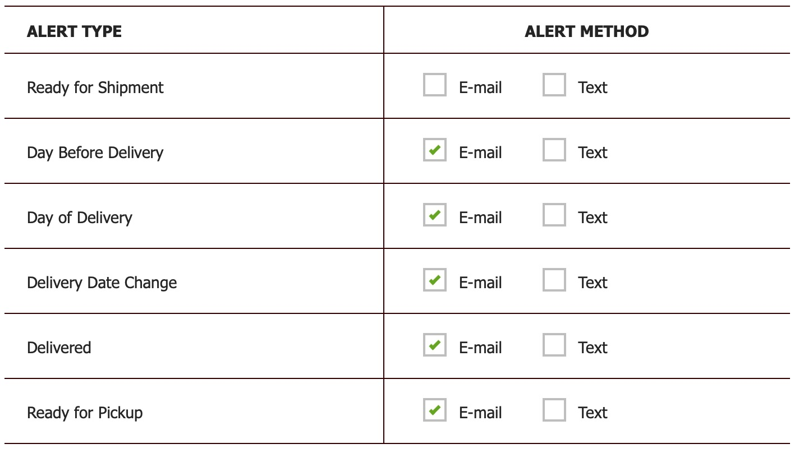

This list covers the notification setup required for each supported shipper. For the full set of email addresses and subject patterns used, see [const.py](https://github.com/moralmunky/Home-Assistant-Mail-And-Packages/blob/dev/custom_components/mail_and_packages/const.py).

---

## North America

Shipper | Setup Required
--- | ---
[**USPS Informed Delivery**](https://informeddelivery.usps.com/) | Create an Informed Delivery account and enable all email notifications for the address the integration will monitor. | 
[**FedEx Delivery Manager**](https://www.fedex.com/en-us/delivery-manager.html) | Create a Delivery Manager account and enable all email notifications. | 
[**UPS My Choice**](https://www.ups.com/us/en/services/tracking/mychoice.page) | Create a My Choice account and enable all email notifications. | 
[**Amazon**](https://www.amazon.com) | Enable shipping and delivery email notifications on your Amazon account. For packages shipped by Amazon's own contractors, see [Email Forwarding](Email-Forwarding).
[**Walmart**](https://www.walmart.com) | Enable shipping and delivery email notifications on your Walmart account.
[**The Home Depot**](https://www.homedepot.com/) | Enable shipping and delivery email notifications on your Home Depot account.
[**Canada Post**](https://www.canadapost-postescanada.ca/) | Enable email delivery notifications on your Canada Post account.
[**Purolator**](https://www.purolator.com/) | Enable email shipping and delivery notifications on your Purolator account.
[**Intelcom / Dragonfly**](https://intelcom.ca/) | Enable shipping and delivery email notifications.
[**Bonshaw Distribution**](https://bonshawdelivery.com/) | Enable delivery notification emails.

---

## Europe

Shipper | Setup Required
--- | ---
[**DHL / DHL Express / DHL Parcel**](https://www.dhl.com/) | Enable email delivery notifications on your DHL account or parcel tracking. Marketplace emails that identify DHL eCommerce as the carrier (including `420…` DHL eCommerce tracking numbers) also count under the DHL sensors.
[**Deutsche Post (Post DE)**](https://www.deutschepost.de/) | Enable Briefankündigung email notifications for incoming mail.
[**Post AT (Austrian Post)**](https://www.post.at/) | Enable MeineSendung email notifications.
[**Royal Mail**](https://www.royalmail.com/) | Enable email delivery notifications.
[**Hermes / Evri**](https://www.evri.com/) | Enable email delivery notifications on your Evri account.
[**DPD (dpd.de & dpd.com.pl)**](https://www.dpd.com/) | Enable email delivery notifications on your DPD account.
[**GLS**](https://gls-group.com/) | Enable email delivery notifications on your GLS account.
[**InPost (Poland)**](https://inpost.pl/) | Enable email delivery notifications on your InPost account.
[**Poczta Polska**](https://www.poczta-polska.pl/) | Enable eINFO email delivery notifications.
[**PostNL**](https://www.postnl.nl/) | Enable email delivery notifications on your PostNL account.
[**REWE Lieferservice**](https://www.rewe.de/) | Enable delivery note email notifications.

---

## Oceania

Shipper | Setup Required
--- | ---
[**Australia Post**](https://auspost.com.au/) | Enable email delivery notifications on your Australia Post account.

---

## E-Commerce & Property Services

Service | Setup Required
--- | ---
[**AliExpress**](https://www.aliexpress.com/) | Enable order and delivery notifications in your AliExpress account settings.
[**Etsy**](https://www.etsy.com/) | Enable dispatch and delivery email notifications on your Etsy account.
[**eBay**](https://www.ebay.com) | Enable shipping email notifications on your eBay account. Delivering only — there is no eBay delivered sensor yet, as no genuine delivered sample is available.
[**Shopify**](https://www.shopify.com/) | Standard Shopify order and delivery notification emails are automatically parsed, including stores that mail from their own domains.
[**PledgeBox**](https://www.pledgebox.com/) | PledgeBox shipment notification emails are automatically parsed (in-transit only — there is no PledgeBox delivered sensor yet, as no genuine delivered sample is available).
[**4PX**](https://www.4px.com/) | No direct 4PX email is parsed yet. Full 4PX tracking numbers found in PledgeBox notices are attributed to the 4PX sensors; a package reported by both counts once (the carrier wins).
[**BuildingLink**](https://www.buildinglink.com/) | Front desk / concierge package arrival notification emails are automatically parsed.

---

## Delivery Confirmation Support Matrix

Delivery-confirmation support is **not** uniform across carriers. This is the short version; the full matrix is in the repository's `docs/architecture.md` (section 9), and the Amazon recipes are on [Amazon Delivery Confirmations](Amazon-Delivery-Confirmations).

| Source | Delivering / Delivered | Exception with matchable numbers | Attempted / missed detection |
| --- | --- | --- | --- |
| **Amazon** (direct) | Yes / Yes | Yes — order numbers on `order` | **Yes** — order numbers on `order` |
| **USPS, UPS, FedEx, Walmart, Home Depot** | Yes / Yes | Yes — tracking numbers on `tracking_#` | No |
| **PostNL** | Yes / Yes | Yes — tracking numbers on `tracking_#` | **Yes** — the "we missed you" notice is the PostNL exception email |
| **DHL** (direct) | Yes / Yes | No | No — but DHL receives DHL eCommerce packages attributed from marketplace mail |
| **eBay** | Yes / No (no delivered sample yet) | No | No |
| **PledgeBox** | In-transit only / No (no delivered sample yet) | No | No |
| **4PX** | In-transit only, via PledgeBox attribution / No | No | No |
| **All other supported carriers** | Yes / Yes | No | No |

Attempted/missed detection exists only for Amazon and PostNL, and exception entries exist only for USPS, UPS, FedEx, Walmart, Home Depot, PostNL, and Amazon. Exception numbers never set or override the delivering counts — they exist so templates can match an exception to a later delivery and clear when it lands.

---

> **Don't see your shipper?** Check [const.py](https://github.com/moralmunky/Home-Assistant-Mail-And-Packages/blob/dev/custom_components/mail_and_packages/const.py) for the complete list of supported email patterns, or open an [issue](https://github.com/moralmunky/Home-Assistant-Mail-And-Packages/issues) to request support for a new shipper.
